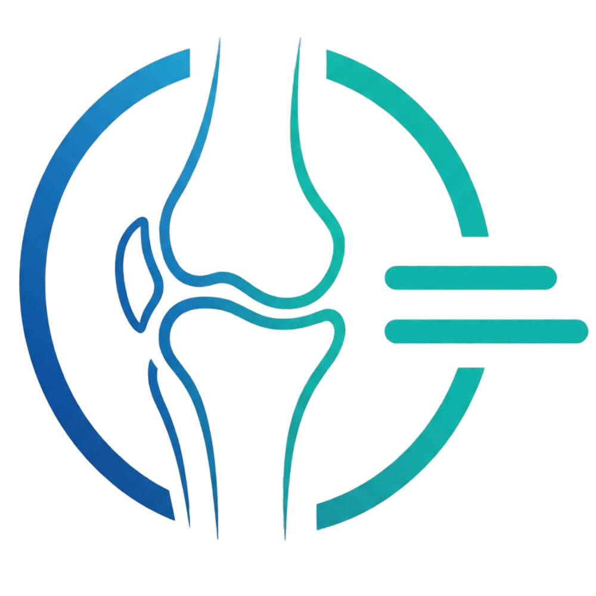
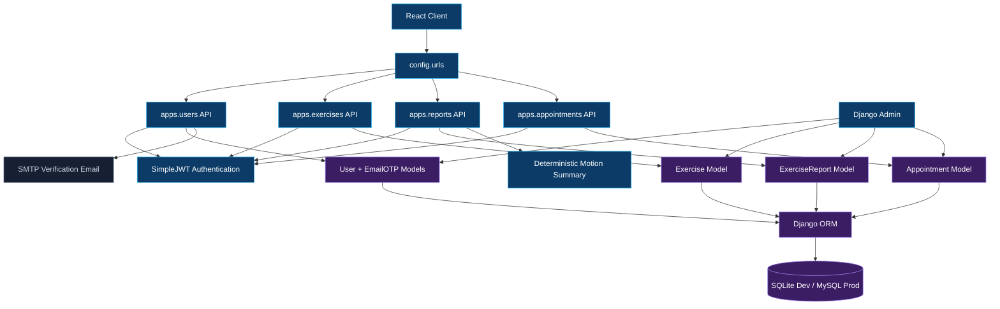
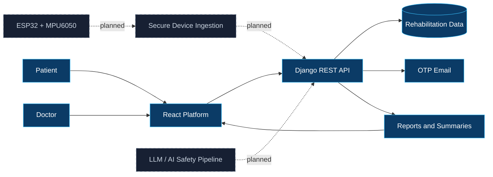
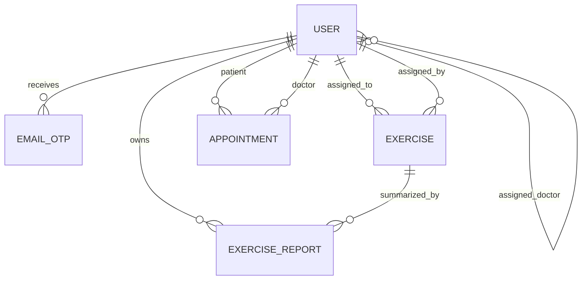
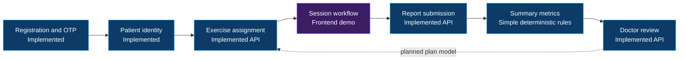
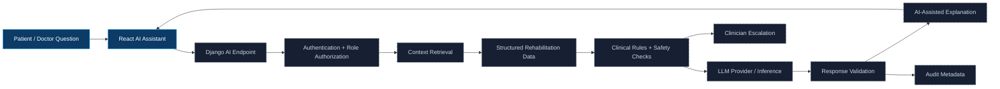
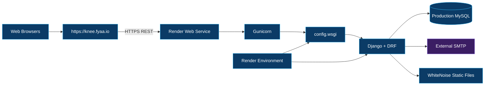
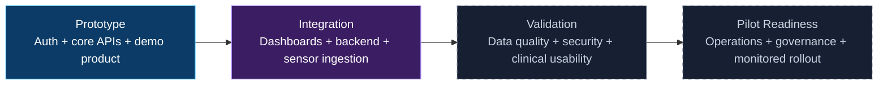

<div align="center">
  
  <h1>KneeGuide Backend</h1>
  <p><strong>Secure application services for connected knee rehabilitation.</strong></p>
  <p>Django REST APIs for identity, rehabilitation exercises, motion reports, and appointments.</p>

  <p>
    <a href="#current-development-status"></a>
    <a href="#medathon--team"></a>
    <a href="#technology-stack"></a>
    <a href="#technology-stack"></a>
  </p>
  <p>
    <a href="https://knee.fyaa.io/">Live Platform</a> ·
    <a href="https://kneeguide-backend.onrender.com/">Backend Service</a> ·
    <a href="https://github.com/KneeGuide-Team/kneeguide-frontend">Frontend Repository</a> ·
    <a href="https://fyaa.io/">Developer Portfolio</a>
  </p>
</div>

<br />


> [!IMPORTANT]
> KneeGuide is an advanced medical-technology prototype. The backend stores and analyzes rehabilitation data, but it is not evidence of clinical effectiveness, diagnostic accuracy, regulatory approval, or medical-device certification.

## Contents

- [Backend Overview](#backend-overview)
- [Current Development Status](#current-development-status)
- [Technology Stack](#technology-stack)
- [System Architecture](#system-architecture)
- [Django Application Structure](#django-application-structure)
- [Data Models](#data-models)
- [REST API Design](#rest-api-design)
- [Authentication and Authorization](#authentication-and-authorization)
- [Rehabilitation Management](#rehabilitation-management)
- [Reports and Clinical Monitoring](#reports-and-clinical-monitoring)
- [Appointment Management](#appointment-management)
- [AI / LLM Integration](#ai--llm-integration)
- [Wearable Sensor Integration](#wearable-sensor-integration)
- [Security and Privacy](#security-and-privacy)
- [Database Architecture](#database-architecture)
- [Local Setup](#local-setup)
- [Environment Variables](#environment-variables)
- [Database Migrations](#database-migrations)
- [Testing](#testing)
- [Deployment](#deployment)
- [Production Readiness](#production-readiness)
- [Roadmap](#roadmap)
- [Related Frontend Repository](#related-frontend-repository)
- [MEDATHON & Team](#medathon--team)

## Backend Overview

The KneeGuide backend is the authenticated application and persistence layer for the platform. It provides REST endpoints for:

- Patient and doctor accounts.
- Email availability, registration, bilingual OTP email, OTP verification, resend, and login.
- JWT-authenticated profile access.
- Doctor-assigned rehabilitation exercises.
- Exercise reports containing motion samples and derived summary fields.
- Patient/doctor dashboard summaries.
- Doctor review fields for reports.
- Doctor-owned appointment creation, update, cancellation, and role-aware listing.
- Django Admin operations for managed prototype data.

The backend does not currently contain a device registry, sensor-ingestion transport, firmware, an AI model integration, or an LLM orchestration layer.

## Current Development Status

| Component | Current Status | Data Source | Remaining Work |
|---|---|---|---|
| Public website | Implemented in companion frontend | React static application | Continue content and accessibility QA |
| Authentication | Implemented | Django user model, JWT access tokens | Refresh-token flow, throttling, operational audit controls |
| Registration and OTP | Implemented | MySQL/SQLite + SMTP | Delivery observability and stronger OTP generation/rate limiting |
| Patient dashboard | Partially Implemented | Summary endpoint exists; frontend uses demo domain | Expand API and connect frontend |
| Doctor dashboard | Partially Implemented | Aggregate endpoint exists; frontend uses demo domain | Assigned-patient scoping and frontend integration |
| Exercises | Implemented API core | Exercise model and endpoints | Session/program domain, richer validation, test coverage |
| Appointments | Implemented API core | Appointment model and endpoints | Patient-request workflow alignment and test coverage |
| Reports | Partially Implemented | ExerciseReport + simple deterministic analysis | Validate sample schema, analysis methodology, and tests |
| AI Assistant | Demo / Mock Data in frontend | Deterministic browser logic | Backend orchestration, safety rules, optional LLM |
| Backend APIs | Partially Implemented | Django REST Framework | Versioning, schema documentation, pagination, broader tests |
| Database | Implemented | SQLite development; MySQL production | Backups, monitoring, retention and recovery procedures |
| Sensor prototype | Not Verified | ESP32/MPU6050 stated technology; no firmware here | Firmware, calibration, protocol and bench evidence |
| IoT integration | Planned | No device or ingestion modules | Secure ingestion, association, validation and observability |
| LLM integration | Planned | No provider or inference code | Context retrieval, guardrails, response validation and audit trail |
| Clinical validation | Planned | No study or validation artifacts | Clinician review, usability/safety protocol, pilot governance |

## Technology Stack

Versions are taken from the locked Python requirements and inspected runtime.

| Area | Technology |
|---|---|
| Runtime | Python 3.12 |
| Web framework | Django 5.2.8 |
| REST API | Django REST Framework 3.16.1 |
| Authentication | djangorestframework-simplejwt 5.5.1 |
| Development database | SQLite |
| Production database | MySQL via PyMySQL 1.1.2 |
| Application server | Gunicorn 23.0 |
| Static files | WhiteNoise 6.11 |
| CORS | django-cors-headers 4.9 |
| Email | Django SMTP backend, multipart bilingual templates |
| Environment loading | python-dotenv 1.2.1 |

## System Architecture

### Backend architecture



### Cross-platform ecosystem



| Visual state | Meaning |
|---|---|
| Blue | Implemented component or service |
| Dashed slate | Planned integration not present in current code |

## Django Application Structure

```text
kneeguide-backend/
├── apps/
│   ├── users/          # Custom user, OTP, auth APIs, email service, Admin
│   ├── exercises/      # Exercise assignment model and endpoints
│   ├── reports/        # Motion reports, deterministic analysis, dashboards
│   └── appointments/   # Doctor/patient appointment records and endpoints
├── config/
│   ├── settings/
│   │   ├── base.py
│   │   ├── development.py
│   │   └── production.py
│   ├── urls.py
│   ├── asgi.py
│   └── wsgi.py
├── docs/
│   └── assets/         # README branding assets
├── manage.py
├── Procfile
├── requirements.txt
└── README.md
```

| Application | Responsibility | Evidence-based maturity |
|---|---|---|
| `apps.users` | Custom roles, clinician assignment, OTP, JWT login, profile, Admin | Implemented core with focused tests |
| `apps.exercises` | Doctor-created exercise assignments and patient listing | Implemented core; minimal tests |
| `apps.reports` | Motion JSON, summary calculation, patient/doctor views, doctor review | Partially implemented |
| `apps.appointments` | Doctor-owned scheduling, detail, update, cancellation, lists | Implemented core; minimal tests |

App labels remain `users`, `exercises`, `reports`, and `appointments` so migration identity is stable after the package reorganization.

## Data Models

### User and verification

- `User` extends Django `AbstractUser`.
- Email is unique and is the authentication field.
- Roles are `patient` and `doctor`.
- Patient records may reference an assigned doctor.
- Doctor specialization and availability are stored on the same model.
- `EmailOTP` stores a six-digit code, creation time, verification flag, and failed-attempt count.

### Exercise

- Title, description, repetitions, sets, optional notes, and optional video URL.
- Optional patient assignment through `assigned_to`.
- Optional clinician authorship through `assigned_by`.

### ExerciseReport

- Patient and optional exercise relation.
- JSON motion samples.
- Maximum angle, reference angle, deviation, performance status, and duration.
- Start/end timestamps.
- Doctor rating and notes.
- Completed/missed status.

### Appointment

- Doctor and patient relations.
- Date, time, optional reason, and scheduled/completed/cancelled status.



## REST API Design

All paths are relative to `/api/`.

### Users

| Method | Endpoint | Access | Purpose |
|---|---|---|---|
| POST | `users/check-email/` | Public | Validate and check normalized email availability |
| POST | `users/register/` | Public | Create inactive user, assign available doctor, create/send OTP |
| POST | `users/verify-otp/` | Public | Verify latest OTP and activate user |
| POST | `users/resend-otp/` | Public | Send a new OTP with request limiting |
| POST | `users/login/` | Public | Authenticate and return access token + role data |
| GET | `users/me/` | JWT | Return current profile |

### Exercises

| Method | Endpoint | Access | Purpose |
|---|---|---|---|
| POST | `exercises/create/` | Doctor | Create assignment; creator forced to current user |
| GET | `exercises/patient/<patient_id>/` | JWT | List assignments with patient self-access protection |

### Reports

| Method | Endpoint | Access | Purpose |
|---|---|---|---|
| POST | `reports/submit/` | JWT | Store motion data and deterministic summary |
| GET | `reports/patient/<patient_id>/` | JWT | List a patient’s reports |
| GET | `reports/dashboard/<patient_id>/` | JWT | Latest report, angle, assigned exercises |
| GET | `reports/doctor/dashboard/` | Doctor | Aggregate patient summary |
| PATCH | `reports/<report_id>/update/` | Doctor | Update rating, notes, or status |

### Appointments

| Method | Endpoint | Access | Purpose |
|---|---|---|---|
| POST | `appointments/create/` | Doctor | Create appointment owned by current doctor |
| GET | `appointments/<id>/` | Owner or staff | Retrieve appointment |
| PUT/PATCH | `appointments/<id>/update/` | Owning doctor | Update appointment |
| DELETE | `appointments/<id>/cancel/` | Owning doctor | Mark appointment cancelled |
| GET | `appointments/patient/<patient_id>/` | JWT, role-scoped | List patient appointments |
| GET | `appointments/doctor/<doctor_id>/` | Same doctor | List doctor appointments |

The API has no explicit version prefix, generated OpenAPI schema, or pagination configuration yet.

## Authentication and Authorization

- Django’s custom user authenticates by email.
- Registration normalizes email, hashes passwords, marks users inactive, and activates them only after OTP verification.
- Password registration requires uppercase, lowercase, number, symbol, and a minimum of eight characters.
- Login returns a SimpleJWT access token; a refresh-token endpoint is not exposed.
- DRF defaults to JWT authentication and authenticated access.
- Public auth views explicitly use `AllowAny`.
- Role permission classes restrict doctor-only exercise and appointment creation.
- Object checks restrict appointment access and prevent patients from requesting other patients’ exercise/report lists.
- Last-activity middleware attempts JWT authentication and stores `last_activity`.

The current doctor dashboard and report endpoints can access broad patient collections; assigned-clinician scoping should be reviewed before clinical deployment.

## Rehabilitation Management

The backend implements exercise assignment and report submission primitives. It does not yet model a full rehabilitation program, prescription schedule, session state machine, adherence plan, or device.

The frontend demonstrates those richer concepts locally. A future integration should make the backend the source of truth while preserving role checks, timestamps, provenance, and immutable source measurements.

### Patient workflow across current components



## Reports and Clinical Monitoring

`ExerciseReport` accepts a JSON array of motion points and derives:

- Maximum observed angle.
- Absolute deviation from a supplied reference angle.
- A simple threshold label: excellent, good, or poor.
- Duration from the last sample’s `time` value.

This is deterministic prototype logic, not a trained model and not a clinically validated algorithm. The code currently assumes valid point structure and does not define sampling frequency, calibration status, unit metadata, or data-quality flags. Those controls are required before sensor measurements can support clinical interpretation.

Doctors can set rating, notes, and completed/missed status through the update endpoint.

## Appointment Management

The implemented backend workflow is doctor-led:

- A doctor creates an appointment for a patient.
- The owning doctor may update or cancel it.
- Patients may list their own appointments and access permitted details.
- Doctors may list their own appointments and filtered patient appointments.

The richer patient-request, alternative-time, accept/decline workflow shown by the frontend is currently demo-domain functionality and is not represented by the backend model’s three statuses.

## AI / LLM Integration

No AI SDK, model provider, vector database, prompt pipeline, or LLM endpoint exists in this backend. The frontend assistants are deterministic.

The following is a **planned safety-oriented architecture**, not current functionality:



Safety boundary: an LLM must not independently diagnose, prescribe, change a rehabilitation plan, or override clinician decisions. Responses require source-aware context, role controls, uncertainty handling, validation, and escalation paths.

## Wearable Sensor Integration

The stated prototype hardware is ESP32 plus MPU6050. Neither firmware nor a backend device/ingestion module is present, so hardware behavior and integration status are **not verified**.

### Intended IoT data flow

```mermaid
flowchart LR
    SENSOR[Wearable Knee Sensor<br/>MPU6050] --> MCU[ESP32 Microcontroller]
    MCU --> CAL[Calibration + Local Validation]
    CAL --> WIRELESS[Wireless Communication]
    WIRELESS --> INGEST[Secure Data Ingestion]
    INGEST --> AUTH[Device Identity + Patient Association]
    AUTH --> API[Django Backend]
    API --> STORE[(Timestamped Sensor Storage)]
    STORE --> PROCESS[Motion Processing]
    PROCESS --> ROM[Range-of-Motion Metrics]
    ROM --> PROGRESS[Rehabilitation Progress Analysis]
    PROGRESS --> DASH[Patient + Doctor Dashboards]
    PROGRESS --> AI[AI-Assisted Interpretation]
    AI --> REVIEW[Clinician Review]

    classDef hardware fill:#3b1d63,stroke:#a78bfa,color:#fff;
    classDef planned fill:#172033,stroke:#64748b,color:#cbd5e1,stroke-dasharray:5 5;
    class SENSOR,MCU hardware;
    class CAL,WIRELESS,INGEST,AUTH,API,STORE,PROCESS,ROM,PROGRESS,DASH,AI,REVIEW planned;
```



Before integration, the design must define:

- Sensor calibration and recalibration conditions.
- Measurement units, sample rate, timestamps, clock drift, and missing samples.
- Device identity, provisioning, revocation, and device-to-patient association.
- Authenticated encryption and replay protection.
- Payload/schema validation and idempotent ingestion.
- Data-integrity, battery, connectivity, and reliability telemetry.
- Separation between measured values, derived metrics, and clinician interpretation.

## Security and Privacy

### Implemented controls

- Production `DEBUG=False`.
- Mandatory production secret and database environment variables.
- HTTPS redirect and secure session/CSRF cookies.
- Proxy SSL header for Render.
- Explicit CORS and CSRF trusted-origin lists.
- JWT authentication and role/object permission checks.
- Django password hashing; raw passwords are not stored.
- OTP expiry, failed-attempt ceiling, and resend request limit.
- Strict MySQL transaction mode.
- Registration transaction rollback when email delivery fails.
- WhiteNoise static-file serving.

### Remaining hardening

- Replace `random.randint` OTP generation with a cryptographically secure generator.
- Add DRF throttling for authentication and sensitive endpoints.
- Add refresh-token rotation/revocation if refresh tokens are introduced.
- Add structured security and audit logging without recording passwords, tokens, or OTP values.
- Review doctor access against assigned-patient relationships.
- Validate motion payload shape, size, sampling metadata, and numerical bounds.
- Establish backup, restore, retention, consent, deletion, incident-response, and secrets-rotation procedures.
- Perform dependency, SAST, DAST, penetration, privacy, and threat-model reviews.

No regulatory or healthcare compliance certification is claimed.

## Database Architecture

Development uses repository-local SQLite through `config.settings.development`. Production uses MySQL through `config.settings.production` with `utf8mb4` and `STRICT_TRANS_TABLES`.

The production provider is intentionally not named because repository configuration supplies host details through environment variables and does not identify the vendor.

## Local Setup

### Prerequisites

- Python 3.12 recommended.
- Existing MySQL access only if explicitly testing production settings.

### Windows PowerShell

```powershell
git clone https://github.com/KneeGuide-Team/kneeguide-backend.git
cd kneeguide-backend
python -m venv .venv
.\.venv\Scripts\Activate.ps1
python -m pip install -r requirements.txt
python manage.py migrate
python manage.py runserver
```

### macOS / Linux

```bash
git clone https://github.com/KneeGuide-Team/kneeguide-backend.git
cd kneeguide-backend
python3 -m venv .venv
source .venv/bin/activate
python -m pip install -r requirements.txt
python manage.py migrate
python manage.py runserver
```

Local management commands default to `config.settings.development`.

## Environment Variables

Do not commit `.env`.

| Variable | Environment | Required | Purpose |
|---|---|---:|---|
| `DJANGO_SETTINGS_MODULE` | Render | Yes | Use `config.settings.production` |
| `SECRET_KEY` | Production | Yes | Django signing secret |
| `ALLOWED_HOSTS` | Production | Yes | Comma-separated hostnames |
| `DB_NAME` | Production | Yes | MySQL database |
| `DB_USER` | Production | Yes | MySQL user |
| `DB_PASSWORD` | Production | Yes | MySQL password |
| `DB_HOST` | Production | Yes | MySQL host |
| `DB_PORT` | Production | No | Defaults to `3306` |
| `CORS_ALLOWED_ORIGINS` | Both | Recommended | Comma-separated browser origins |
| `CSRF_TRUSTED_ORIGINS` | Production | Recommended | Trusted HTTPS origins |
| `SECURE_SSL_REDIRECT` | Production | No | Defaults to `True` |
| `DEVELOPMENT_ALLOWED_HOSTS` | Development | No | Local host allow-list |
| `EMAIL_HOST` | Email delivery | Yes for OTP email | SMTP host |
| `EMAIL_PORT` | Email delivery | No | Defaults to SSL port `465` |
| `EMAIL_HOST_USER` | Email delivery | Yes for authenticated SMTP | SMTP account |
| `EMAIL_HOST_PASSWORD` | Email delivery | Yes for authenticated SMTP | SMTP credential |
| `DEFAULT_FROM_EMAIL` | Email delivery | Yes | Sender identity |
| `EMAIL_LOGO_URL` | Email delivery | No | Public HTTPS email logo |

## Database Migrations

```bash
python manage.py makemigrations --check --dry-run
python manage.py migrate --plan
python manage.py migrate
```

Production commands should select settings explicitly:

```bash
python manage.py migrate --plan --settings=config.settings.production
```

Existing migration identities are preserved under the app labels after the filesystem refactor.

## Testing

```bash
python manage.py check
python manage.py makemigrations --check --dry-run
python manage.py test
```

Current focused tests cover:

- Bilingual multipart OTP email rendering.
- Email normalization and availability.
- Registration, resend, verification, and login lifecycle.
- Transaction rollback when email delivery fails.
- Case-insensitive duplicate registration.
- Patient and doctor creation through Django Admin with password hashing.

The exercises, reports, and appointments test modules currently contain only Django’s generated placeholder and require substantive endpoint, permission, validation, and database tests.

## Deployment

The backend is deployed as a Render web service.

Recommended Render configuration:

```text
Root Directory: <repository root>
Build Command:
pip install -r requirements.txt && python manage.py collectstatic --noinput --settings=config.settings.production && python manage.py migrate --settings=config.settings.production

Start Command:
gunicorn config.wsgi:application
```

The repository `Procfile` also declares Gunicorn with `config.wsgi`.

### Deployment topology



## Production Readiness

KneeGuide is an advanced prototype with deployed identity, database, email, exercise, report, and appointment foundations. It is not yet ready for unsupervised clinical production use.

Before pilot readiness, the project needs:

- End-to-end dashboard/backend integration.
- Device and data-ingestion implementation.
- Defined sensor validation and calibration evidence.
- Expanded automated tests and load/reliability testing.
- API schema/versioning and operational observability.
- Security, privacy, consent, retention, backup and recovery controls.
- Clinical safety and usability review.
- AI governance before any LLM feature is introduced.

## Roadmap



## Related Frontend Repository

The product experience, bilingual public site, authentication screens, and patient/doctor dashboards live in:

**[KneeGuide-Team/kneeguide-frontend](https://github.com/KneeGuide-Team/kneeguide-frontend)**

The frontend README documents which features use the real API and which remain on the demonstration data layer.

## MEDATHON & Team

**Hackathon:** MEDATHON 2026

**Track:** Track 3 — Medical Tools & Devices Innovation
**Team code:** MED-5SBEPA

| Team member | Role |
|---|---|
| **Rakan Alshwihani** | Team Leader — Clinical & Medical Domain |
| **Eng. Fahad Alshwihani** | Lead Software Engineer — Full-Stack Systems, Backend Engineering, System Integration, Architecture & UX/UI Design |
| **Abdulaziz Alshwihani** | IoT & Hardware — Wearable Sensor Prototype and Device Integration |

### Software development credit

Developed and engineered by **Eng. Fahad Alshwihani**.

Portfolio: [fyaa.io](https://fyaa.io/)

Copyright © 2026 KneeGuide Team. All Rights Reserved.

Existing repository license files, when present, remain authoritative. This README does not introduce or alter licensing terms.
